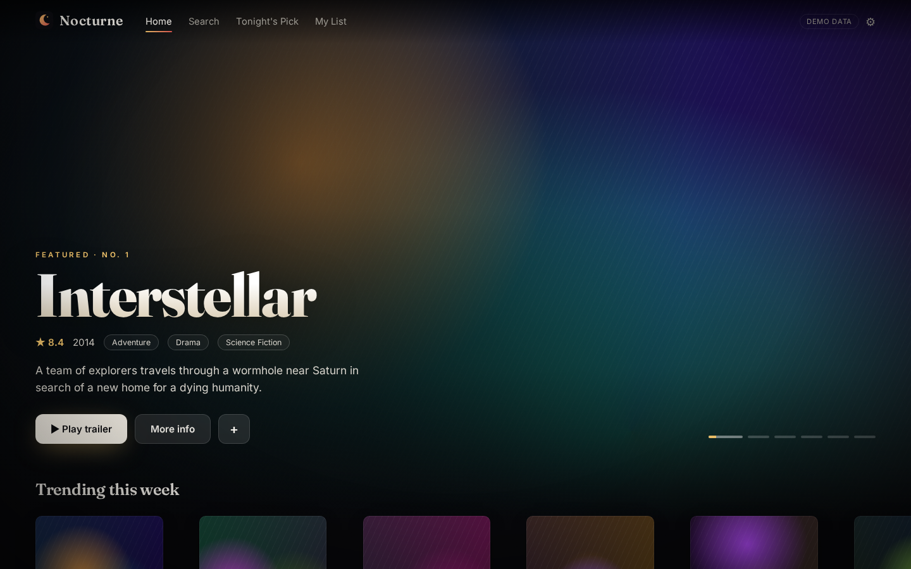
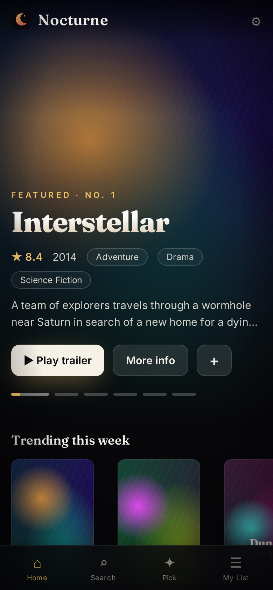
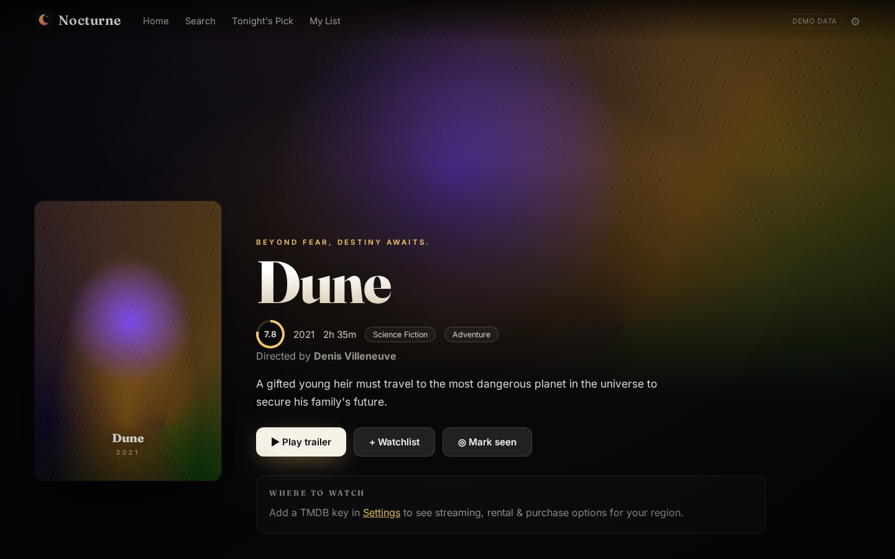
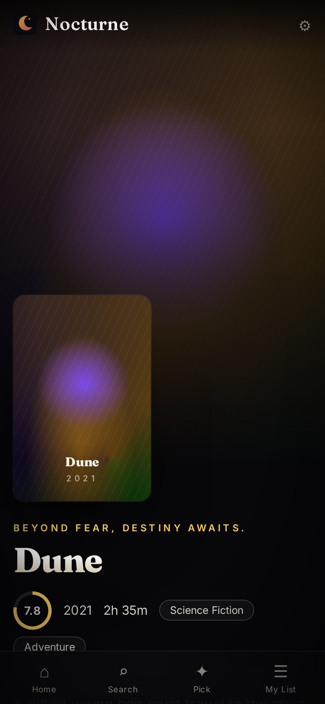
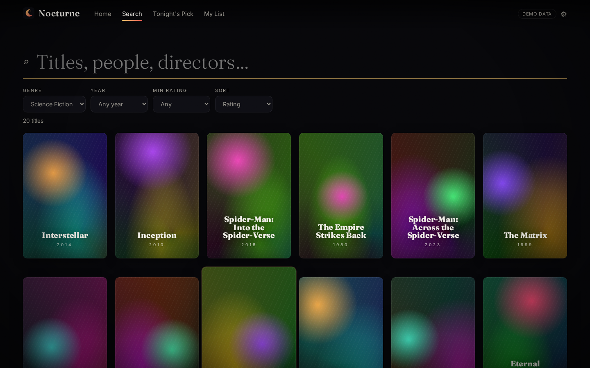
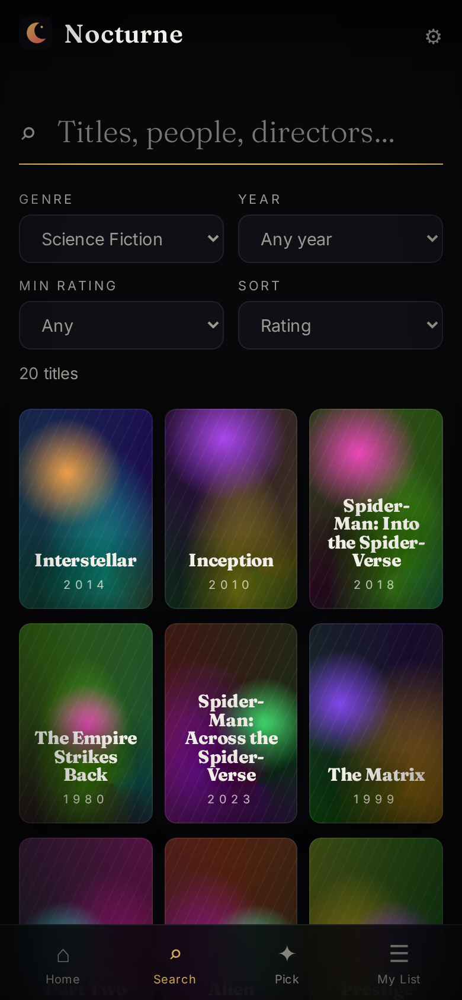
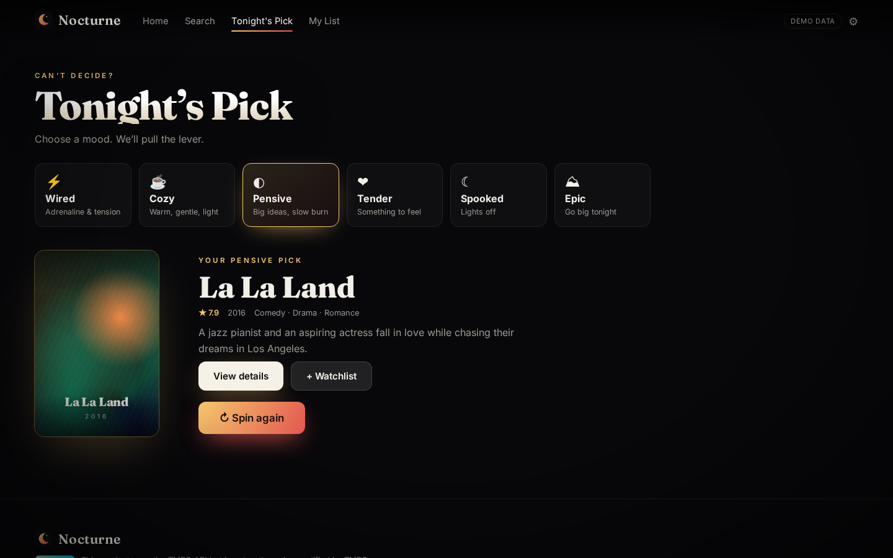
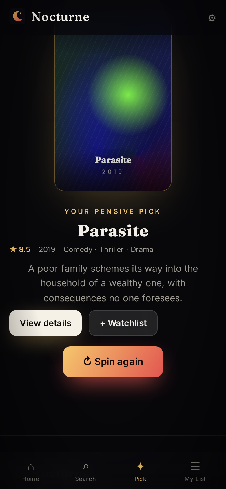
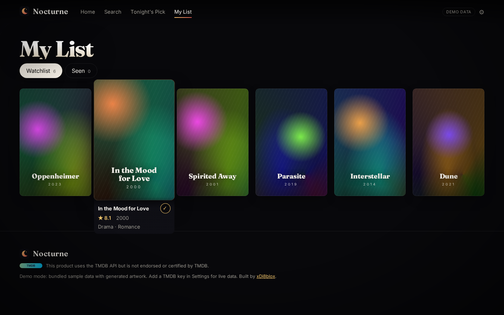
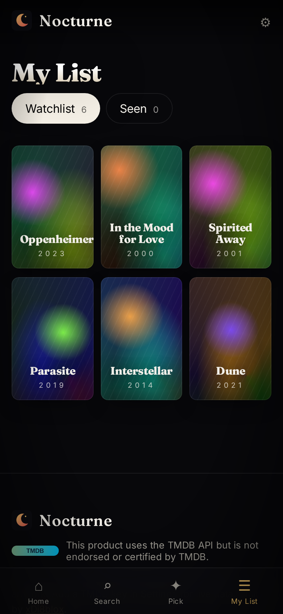

# 🌙 Nocturne — cinema after dark

**A cinematic movie discovery app with the polish of a premium streaming service.** Auto-rotating hero with Ken Burns motion and trailer previews, hover-expanding rows, rich detail pages, instant search, a mood-based *Tonight's Pick* slot machine and a private watchlist — all static, all on GitHub Pages.

**Live demo → https://xdi8blox.github.io/nocturne/**

The demo runs on a bundled 61-title sample catalogue with generated gradient key art (no copyrighted imagery). Paste a free TMDB key in **Settings** to switch to live data: real posters, backdrops, cast photos, trailers and where-to-watch.

## Screenshots

| | Desktop | Mobile |
|---|---|---|
| Home |  |  |
| Detail |  |  |
| Search |  |  |
| Tonight's Pick |  |  |
| My List |  |  |

## Features

- **Cinematic hero**: auto-rotating featured films, crossfades, Ken Burns backdrop, progress dots, pause on hover, YouTube trailer modal on click
- **Rows**: Trending (ranked numerals), Top rated, curated genre shelves and *Because you liked X* from your list; hover-expand cards, arrow buttons, native touch swipe with scroll snap
- **Detail page**: backdrop, rating ring, runtime, genres, director, cast carousel, trailer, similar titles, where-to-watch (TMDB / JustWatch providers when keyed)
- **Search**: instant debounced results with genre, year, minimum rating and sort filters, URL-synced
- **Tonight's Pick**: choose a mood, pull the lever — a slot-machine reel lands on something you haven't seen
- **Watchlist + Seen** stored in localStorage
- **Keyboard**: `/` opens search, Tab through titles, ←/→ along rows, Esc closes trailers; skip link, ARIA labels, reduced-motion support
- Skeleton loaders, Framer Motion page transitions, film grain + vignette, Fraunces/Inter typography, mobile bottom nav

## Setup

```bash
npm install
cp .env.example .env    # optional: VITE_TMDB_KEY=<your TMDB v3 key or v4 read token>
npm run dev
```

No key? It still works with the sample catalogue. You can also paste a key at runtime in **Settings** (saved in localStorage only). Get one at https://www.themoviedb.org/settings/api.

For the deployed site, add a repository secret `TMDB_KEY` to bake a key into the build (note: it will be public in the bundle; the runtime Settings field is the safer option).

Scripts: `npm run build`, `npm run lint`, `npm run shots` (Playwright screenshots against `URL`, default `http://localhost:4173/`).

## Tech

Vite · React 18 · TypeScript (strict) · Framer Motion · React Router (HashRouter for Pages) · hand-written CSS · Playwright · GitHub Actions → GitHub Pages.

## Attribution

 This product uses the TMDB API but is not endorsed or certified by TMDB. Where-to-watch data is provided by JustWatch via TMDB. Sample-mode titles and synopses are for demo purposes; artwork is generated.

## License

MIT © Death (xDi8blox)
